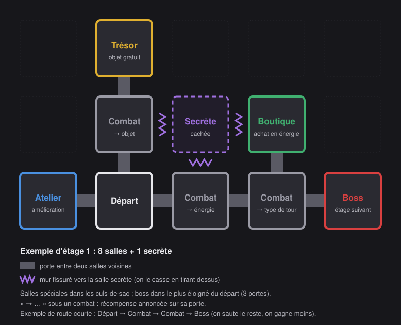

# Carte d'étage

Comment un étage est généré, quelles salles il contient, et comment la carte s'articule avec l'économie d'énergie. Les choix fermés sont aussi résumés dans `docs/decisions.md`.

## Principe

Un étage est un ensemble de salles posées sur une grille, façon Isaac. On commence dans la salle de départ, on passe d'une salle à l'autre par des portes, et le boss ouvre l'étage suivant. Chaque porte annonce ce qu'il y a derrière (type de salle et, pour un combat, sa récompense).

Il n'est **pas obligatoire de vider toutes les salles**. Contourner une salle fait gagner du temps et des PV, mais on rate son énergie et sa récompense. La carte devient donc un choix d'itinéraire.

On peut revenir dans les salles déjà nettoyées (elles restent vides).

## Génération

1. Grille de 9 × 8 cases, une salle = une case (pas de grandes salles pour l'instant).
2. La salle de départ est au centre.
3. On ajoute des salles une par une : on prend une salle existante au hasard, puis un côté au hasard. La nouvelle case est acceptée seulement si elle est libre, dans la grille, et qu'elle **n'aurait qu'un seul voisin**. Cette règle donne des branches et des culs-de-sac plutôt qu'un bloc compact.
4. On s'arrête au nombre de salles voulu. Si on n'a pas assez de culs-de-sac pour les salles spéciales, on recommence avec une autre graine.
5. Les portes sont les côtés qui touchent une autre salle : de 1 à 4 portes selon la carte.
6. Placement des salles spéciales, dans les culs-de-sac :
   - le **boss** dans le cul-de-sac le plus éloigné du départ (en nombre de salles) ;
   - puis Trésor, Boutique, Élite, Atelier/Repos dans les autres culs-de-sac ;
   - toutes les autres salles sont des combats.
7. La **salle secrète** est placée à part : sur une case libre qui touche au moins 2 salles (idéalement 3), sans compter le boss.

La graine du run rend l'étage reproductible (utile pour tester et déboguer).

### Exemple d'étage 1

8 salles : Départ, 3 Combats, Trésor, Boutique, Atelier, Boss, plus la Secrète. Pas d'Élite ici (elle n'est que possible à l'étage 1). Chaque salle n'a été ajoutée qu'à côté d'une seule salle existante, d'où la forme en branches. Les quatre culs-de-sac reçoivent les salles spéciales, le Boss prend le plus éloigné. La Secrète est sur une case vide qui touche trois salles.

## Taille

| Étage | Salles (hors secrète) | Dont combats |
|---|---|---|
| 1 | 8 | 3 à 4 |
| 2 | 10 | ~5 |
| 3 | 12 | ~6 |

Avec des salles de combat de 1 à 1,5 min, un run de 3 étages tient dans 20 à 30 min, d'autant qu'on ne vide pas tout. Valeurs de départ, à régler en jeu.

## Types de salles

| Salle | Présence | Contenu | Ce qu'on y gagne ou dépense |
|---|---|---|---|
| Départ | Toujours, 1 | Vide (tutoriel au premier étage) | — |
| Combat | Le reste | Vagues standard | Énergie ramassée + récompense annoncée sur la porte |
| Boss | Toujours, 1 | Fin d'étage, porte marquée | Objet de boss, accès à l'étage suivant |
| Trésor | Toujours, 1 | Pas de combat | Un objet gratuit |
| Boutique | Toujours, 1 | Pas de combat | Achat en énergie : objets, types de tours, soin |
| Élite (mini-boss) | Possible à l'étage 1, garantie dès l'étage 2 | Combat dur, un ennemi spécial | Objet rare garanti |
| Atelier | 1 chance sur 2 (sinon Repos) | Pas de combat | Amélioration permanente d'un type de tour, payée en énergie |
| Repos | Si pas d'Atelier | Pas de combat | Soin du personnage |
| Secrète | Toujours, 1, cachée | Variable | Récompense généreuse |

**Récompenses de combat annoncées sur la porte** : objet commun, paquet d'énergie, nouveau type de tour, soin. Le joueur choisit son chemin en fonction.

**Trouver la salle secrète** : pas de bombes. Un mur qui donne sur la salle secrète est fissuré ; on l'ouvre en tirant dessus avec le personnage. Un objet pourra plus tard révéler la salle sur la mini-carte.

### Liste des salles et état actuel

| Salle | État |
|---|---|
| Combat | Prototypée (salle grise, branche `proto/salle-grise`) |
| Départ | Conçue |
| Boss | Conçue |
| Trésor | Conçue |
| Boutique | Conçue |
| Élite (mini-boss) | Conçue |
| Atelier | Conçue |
| Repos | Conçue |
| Secrète | Conçue |

Plus tard, à garder en réserve : salle Puzzle, salle Événement, salle de Défi, grandes salles sur plusieurs cases.

## Économie : une seule monnaie, l'énergie

L'énergie est **la seule monnaie du run** (l'or est abandonné). Elle sert à tout : poser des tours en salle, acheter en boutique (objets, types de tours, soin), améliorer à l'atelier.

- On la gagne en ramassant ce que lâchent les ennemis (un peu risqué), et via les récompenses « énergie ».
- Elle suit le joueur d'une salle à l'autre.
- Les tours posées sont démontées à la fin de la salle et rendent 50 % de leur coût.

La tension voulue : chaque tour posée protège maintenant, mais coûte la moitié de son prix à la boutique et à l'atelier. Une salle facile se joue en économisant, une salle dure en investissant. La carte ajoute un second arbitrage : faire un combat de plus pour gagner de l'énergie, ou l'éviter pour garder ses PV.

## Types de tours : 3 emplacements

- Ce qui suit le joueur, ce sont ses **types de tours**, pas les tours posées.
- Le personnage de base commence avec **un seul type : l'Archer** (tir simple).
- On obtient d'autres types par la boutique et les récompenses de combat.
- **3 emplacements** de types de tours. Une fois les 3 remplis, prendre un nouveau type oblige à en remplacer un.
- Certains objets ajoutent un emplacement.
- En salle, on peut poser autant de tours qu'on veut des types qu'on possède, tant qu'on a l'énergie.

## Mini-carte

Affiche les salles visitées et les salles voisines (avec l'icône de leur type). Les salles plus lointaines restent cachées, sauf objet qui les révèle. La salle du boss est visible dès le départ (direction à suivre).

## Questions ouvertes

- Prix en énergie de la boutique et de l'atelier, quantité d'énergie gagnée par salle.
- Le soin de la boutique et du Repos : combien de PV ?
- Peut-on revendre ou remplacer un type de tour en boutique, et contre combien ?
- Mini-carte : le boss doit-il vraiment être visible dès le départ ?
